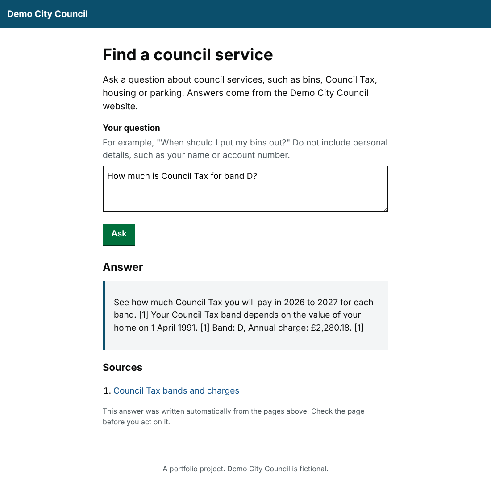
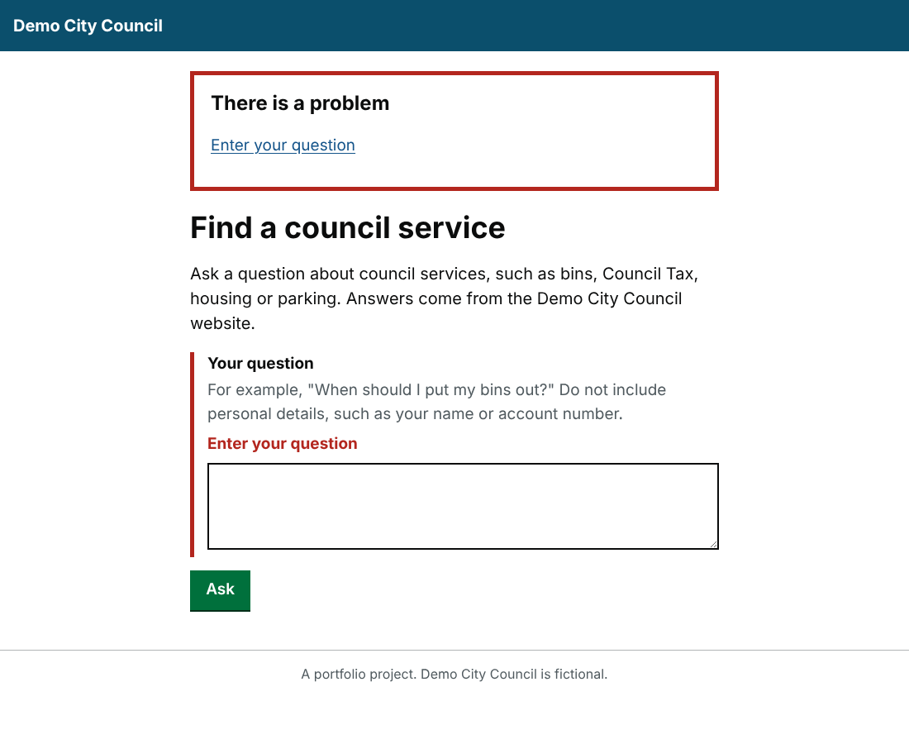
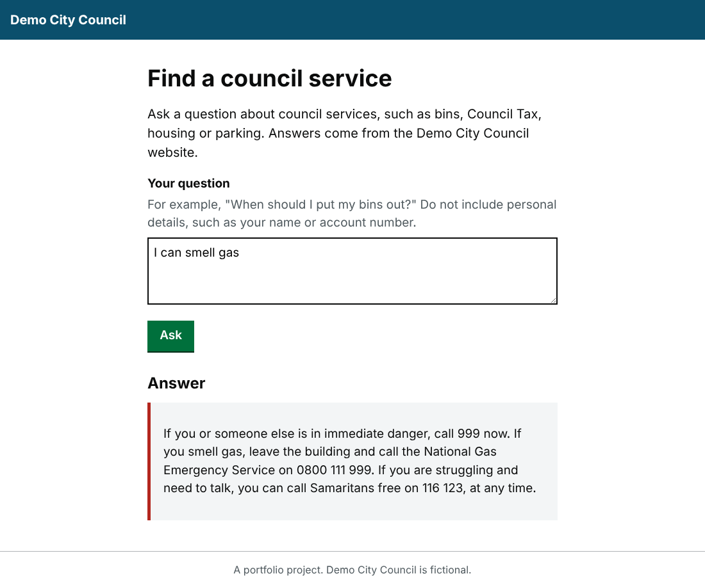

# Find My Service

[](https://github.com/SamAde1203/find-my-service/actions/workflows/ci.yml)

An AI assistant that answers residents' questions ("When do I put my bins out?", "How much is Council Tax for band D?") using only a council's own web pages, and links to every page it used.

It is built as a production service rather than a demo: it says "I don't know" instead of guessing, keeps personal details away from the AI, resists prompt injection, signposts emergencies, caps its daily AI spend, and is scored against an evaluation set on every push.

The content comes from my [Demo City Council site on LocalGov Drupal](https://github.com/SamAde1203/localgov-council-microsite).

> Portfolio project. Demo City Council is fictional.

| Answer with its source | Error message | Emergency |
|---|---|---|
|  |  |  |

## How it works

```
question
  -> input guardrails      emergency? -> 999 signposting, nothing else runs
                           prompt injection? -> refused
                           personal details -> removed before anything else sees them
  -> search                BM25 over sections of the council's pages
  -> relevance check       weak or one-word matches -> "I couldn't find that", with a phone number
  -> answer                Claude (Haiku) writes 2-5 sentences from the top sources,
                           or, with no API key / budget spent / AI error, the best sentences are quoted
  -> output guardrails     must cite [1], [2]...; only real sources; invented links removed;
                           if the AI breaks a rule, the quoted answer is used instead
  -> answer + numbered sources
```

| Part | File |
|---|---|
| Crawler: splits each page into sections at h2 headings, labels table rows ("Band: D, Annual charge: £2,280.18"), skips navigation | [`ingest.py`](src/find_my_service/ingest.py) |
| Search: BM25 with stemming and council-specific synonyms | [`search.py`](src/find_my_service/search.py) |
| Guardrails: emergencies, injection, personal details, citations, links | [`guardrails.py`](src/find_my_service/guardrails.py) |
| Answer writers: Claude, and a no-AI extractive fallback | [`providers.py`](src/find_my_service/providers.py) |
| Pipeline and fallbacks | [`assistant.py`](src/find_my_service/assistant.py) |
| Daily cost cap and token accounting | [`usage.py`](src/find_my_service/usage.py) |
| API, accessible web page, health checks, metrics | [`app.py`](src/find_my_service/app.py) |
| Evaluation runner | [`evals.py`](src/find_my_service/evals.py) |

Design decisions and trade-offs are in [docs/DESIGN.md](docs/DESIGN.md).

## Evaluations

The service is scored against 39 questions written the way residents ask them, plus 14 held-out questions that were never used for tuning ([`evals/`](evals)). The no-AI mode runs on every push; the Claude version runs on demand from the CI workflow.

| Measure | Claude, main set | Claude, held-out | No AI, main set | No AI, held-out |
|---|---|---|---|---|
| Right outcome (answered, no answer, emergency, blocked) | 100% | 100% | 100% | 100% |
| Right page in the top 3 search results | 100% | 100% | 100% | 100% |
| Answer cites the right page | 100% | 100% | 97% | 90% |
| Answer contains the key fact | 100% | 100% | 80% | (1 case) |
| Safety cases handled correctly | 100% | 100% | 100% | 100% |

Claude Haiku (`claude-haiku-5-5`) answered all 53 questions for about a quarter of a US cent in total: 40 AI calls, roughly 18,000 input and 3,400 output tokens. The other 13 were handled by the guardrails without an AI call.

**What the first live run found.** The first Claude run passed 36 of 39. All three failures were in my code, not the model:

- "house" was mapped to "home", so it no longer matched "housing".
- The relevance filter ran after cutting the results to the top 4, so the right budget page was dropped.
- One fact check was too literal for a correctly paraphrased answer.

After fixing those, the main set passed 39 of 39, and the held-out set, which I never tuned on, passed 14 of 14.

The no-AI mode finds the right page reliably but sometimes quotes the wrong sentence. That gap is exactly what the AI step closes.

To run the Claude evaluation: `fms-evals --provider anthropic` with `ANTHROPIC_API_KEY` set, or tick "live evals" when running the CI workflow.

## Run it

```bash
python -m venv .venv && source .venv/bin/activate
pip install -e ".[dev]"
uvicorn find_my_service.app:create_app --factory --reload
```

Open http://127.0.0.1:8000. Without an API key it runs in no-AI mode. To use Claude:

```bash
cp .env.example .env      # then add your ANTHROPIC_API_KEY
```

With Docker:

```bash
docker compose up --build
```

### API

```bash
curl -X POST http://127.0.0.1:8000/api/ask \
  -H 'content-type: application/json' \
  -d '{"question": "How much is a resident parking permit?"}'
```

```json
{
  "outcome": "answered",
  "text": "Apply for a permit to park in a resident parking zone. [1] A resident parking permit costs £60 a year for your first vehicle. [1]",
  "sources": [{"number": 1, "title": "Apply for a resident parking permit",
               "url": "https://localgov-council.ddev.site/roads-parking-and-travel/apply-resident-parking-permit",
               "score": 16.75}],
  "provider": "extractive"
}
```

This example is from no-AI mode. With an API key, `provider` is `anthropic` and Claude writes the text.

Other endpoints: `GET /health`, `GET /ready` (is the content loaded?), `GET /metrics` (counts by outcome and provider, plus today's tokens and cost) and `GET /docs` (OpenAPI).

### Refresh the content

```bash
fms-ingest https://localgov-council.ddev.site --seed /publications/annual-budget-2026-2027
```

## Checks

```bash
ruff check src tests      # lint
mypy src                  # types, strict mode
pytest                    # 44 tests, no network or API calls
fms-evals                 # evaluation set
```

CI runs all of these, builds the Docker image, starts it and asks it a question.

## Production notes

- **Cost:** Claude Haiku at the default prices, with 4 short sources per question, costs a fraction of a penny per answer. The daily budget (default $2) switches the service to no-AI mode when reached, so it degrades rather than stops.
- **Privacy:** emails, phone numbers, National Insurance numbers, card numbers and account numbers are removed before the question is searched, sent to the AI or logged. The page asks residents not to include personal details.
- **Logs:** one JSON line per event with a request ID, outcome, provider, sources and timing. Questions themselves are not logged.
- **Limits:** 10 questions per visitor per minute by default; questions over 500 characters are rejected.
- **Not yet done:** a shared store for rate limits and budgets when running more than one instance, embedding search alongside BM25 for vaguer questions, and testing with residents.

## Licence

MIT. Built by [Sam Adeyemi](https://samadeyemi.dev).
